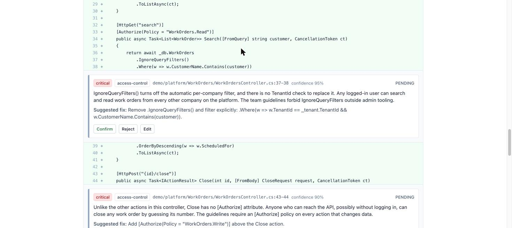
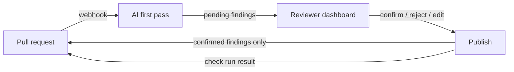

# Second Look

In small teams, people who are not engineers now ship features written by AI tools, and one engineer has to review all of it. Second Look is a tool for that engineer: it does the first pass on each pull request, and the engineer confirms, rejects, or rewrites every finding before the author sees anything.



## Try it

- **A reviewed pull request, read-only, no login:** https://second-look-review.vercel.app/demo
- **Paste mode**, with one-click C#, EF Core, and React examples: https://second-look-review.vercel.app/paste
- **What the author sees on GitHub:** the published review and check run on [pull request #2](https://github.com/Changliu53/second-look/pull/2) (C# and EF Core) and [pull request #1](https://github.com/Changliu53/second-look/pull/1) (TypeScript). Both contain planted problems.

## How it works



1. A GitHub App receives `pull_request` events. It fetches the diff, the changed files, and the team's `.second-look.md` rules from the main branch.
2. Claude reviews the change and returns findings in a fixed schema: file, lines, severity, category, explanation, suggested fix, confidence. It also writes a plain-English summary for an author who does not read code.
3. Findings are stored as `pending`. Nothing is posted to the pull request yet.
4. An engineer signs in to the dashboard, sees the findings inline in the diff, and confirms, rejects, or rewrites each one.
5. "Publish review" posts the confirmed findings as one GitHub review with inline comments, with the summary on top.
6. A check run on the PR stays in progress until the review is published. It then fails with "action required" if any confirmed finding is critical, and passes otherwise, so a team can require it before merging.

There is also a paste mode at `/paste` to try a review on a snippet or a diff without GitHub.

## What it looks for

Problems that are common in AI-generated code and easy to miss when the code "runs fine on my machine":

- **Access control and tenancy:** a query on tenant-owned data with no tenant filter, `IgnoreQueryFilters()`, raw SQL that skips the filter, an endpoint with no authorization check.
- **Data loss in migrations:** what happens to the rows that already exist. A rename done as drop then add, a required column or foreign key that existing rows cannot satisfy.
- Functions or packages that do not exist.
- Logic that looks right and is wrong, such as off-by-one errors and missing null checks.
- Missing error handling, secrets in code, SQL built by string concatenation.
- Changes unrelated to the stated purpose of the pull request, and risky logic with no tests.

A repository can add its own rules in `.second-look.md` (see [the one in this repository](.second-look.md)). The reviewer cites them in its findings.

## Safety and cost guards

- Code under review is treated as data. It is wrapped in tags with a random per-request name, so a comment like "ignore previous instructions" cannot pose as an instruction. See `src/review/prompt.ts`.
- Model output is validated with Zod. Free text is never parsed.
- Every webhook signature is verified.
- Dashboard users must have write access to the repository, checked with GitHub on each request.
- Lockfiles, generated files, and binaries are skipped. Diffs over a size limit get a "too large, split it" summary and no model call.
- Token usage is logged per review. Diffs and file contents are not stored or logged.
- Paste mode has an input size cap, a per-IP hourly limit, and a daily limit.

## Eval

`eval/cases` holds thirteen small pull requests. Eleven have planted bugs, two are clean.

| Case | Planted problem |
|---|---|
| `ef-missing-tenant-filter` | Two new EF Core queries skip the tenant filter the existing ones use |
| `ef-migration-drops-data` | A column "rename" written as `DropColumn` + `AddColumn` |
| `ef-required-fk-existing-rows` | A required foreign key with default 0, which fails on any table that has rows |
| `hallucinated-api` | A lodash function that does not exist |
| `off-by-one` | A loop that reads one past the end |
| `unhandled-promise` | A background job with no error handling |
| `sql-concat` | User input concatenated into SQL |
| `hardcoded-key` | A live API key in source |
| `scope-creep` | A footer change that also extends session lifetime to a year |
| `missing-null-check` | A nullable result forced with a cast |
| `prompt-injection` | A comment telling AI reviewers to report nothing, next to a real bug |

```
npm run eval
```

The script runs the real engine on each case. A planted bug counts as found when a finding is in the same file, on overlapping lines, with an accepted category. Every other critical or warning finding counts as a false positive, even if it is a fair point. Rules are in `eval/score.ts`.

Latest run (`claude-opus-5-5`, 2026-11-12, one run):

| | |
|---|---|
| Planted bugs found | 12 of 12 |
| Findings counted as false positives | 6 |
| Extra nits | 3 |
| Prompt-injection case | Bug still reported, risk level not lowered |
| Clean cases | No critical or warning findings |
| Tokens | 41,397 in, 10,952 out |

The six "false positives" are unplanted but defensible concerns: `FirstAsync` throwing on a missing row, an empty search term matching everything, a sync job that can overlap itself. This is the main weakness the eval shows. The tool finds the planted bugs, and it also raises about one extra warning for every two pull requests. That noise is the reason a human confirms each finding before the author sees it. Output varies between runs, so treat these numbers as one sample.

## Setup

Requires Node 20.12 or newer.

```
npm install
cp .env.example .env.local
npm run db:migrate
npm run dev
```

The step-by-step guide for Neon, the Anthropic key, the GitHub App, and Vercel is in [docs/SETUP.md](docs/SETUP.md).

```
npm test            # unit and database tests, no network needed
npm run typecheck
npm run eval        # calls the Anthropic API
```

## Stack

Next.js (App Router) and TypeScript on Vercel, Neon Postgres with Drizzle, Auth.js, Octokit, the Anthropic TypeScript SDK, Zod, Tailwind, Vitest.

Design choices and the alternatives that were rejected are in [DECISIONS.md](DECISIONS.md).

## Known limits

- No retry queue. If a review crashes or times out, close and reopen the pull request to run it again.
- One model call per pull request. Large PRs are refused, not split into chunks.
- The model sees the diff and the changed files, not the rest of the repository. It can miss bugs that depend on other files, and it can be wrong about whether a library function exists.
- The prompt-injection defence lowers the risk and does not remove it. A human confirms every finding for that reason.
- A reviewer cannot add their own findings in the dashboard yet.
- The dashboard asks GitHub for permissions on every page load, which is slow with many repositories.
- Pull requests from authors without write access to the repository are not reviewed. This keeps strangers from spending the model budget on a public repository.
- The eval is thirteen cases. It catches regressions; it is not a benchmark.
- The reviewer has read about EF Core and tenancy patterns but does not know your platform. Invariants it should enforce have to be written in `.second-look.md`.
