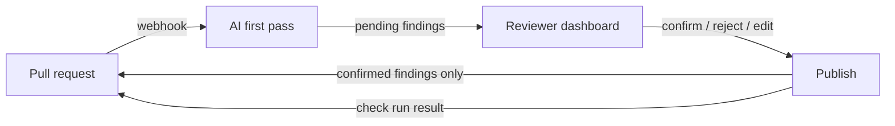

# Second Look

In small teams, people who are not engineers now ship features written by AI tools, and one engineer has to review all of it. Second Look does the first pass on each pull request, and the engineer confirms or rejects every finding before the author sees anything.

Try it without installing anything: https://second-look-review.vercel.app/paste

<!-- Screenshot: add docs/dashboard.png once the app is deployed. -->

## How it works



1. A GitHub App receives `pull_request` events. It fetches the diff, the changed files, and the team's `.second-look.md` rules from the main branch.
2. Claude reviews the change and returns findings in a fixed schema: file, lines, severity, category, explanation, suggested fix, confidence. It also writes a plain-English summary for an author who does not read code.
3. Findings are stored as `pending`. Nothing is posted to the pull request yet.
4. An engineer signs in to the dashboard, sees the findings inline in the diff, and confirms, rejects, or rewrites each one.
5. "Publish review" posts the confirmed findings as one GitHub review with inline comments, with the summary on top.
6. A check run on the PR stays in progress until the review is published. It then fails with "action required" if any confirmed finding is critical, and passes otherwise, so a team can require it before merging.

There is also a paste mode at `/paste` to try a review on a snippet or a diff without GitHub.

## What it looks for

Problems that are common in AI-generated code: functions or packages that do not exist, logic that looks right and is wrong, missing error handling, secrets in code, changes unrelated to the stated purpose of the PR, and risky logic with no tests.

## Safety and cost guards

- Code under review is treated as data. It is wrapped in tags with a random per-request name, so a comment like "ignore previous instructions" cannot pose as an instruction. See `src/review/prompt.ts`.
- Model output is validated with Zod. Free text is never parsed.
- Every webhook signature is verified.
- Dashboard users must have write access to the repository, checked with GitHub on each request.
- Lockfiles, generated files, and binaries are skipped. Diffs over a size limit get a "too large, split it" summary and no model call.
- Token usage is logged per review. Diffs and file contents are not stored or logged.
- Paste mode has an input size cap, a per-IP hourly limit, and a daily limit.

## Eval

`eval/cases` holds ten small pull requests. Eight have one planted bug each (a lodash function that does not exist, an off-by-one, an unhandled promise, SQL string concatenation, a hardcoded API key, an unrelated file changed, a missing null check, a prompt-injection comment next to a real bug). Two are clean.

```
npm run eval
```

The script runs the real engine on each case and reports planted bugs found, false positives (unmatched critical or warning findings), and whether the injection case changed the risk level. Scoring rules are in `eval/score.ts`.

Latest run (`claude-opus-5-5`, 2026-11-12, one run):

| | |
|---|---|
| Planted bugs found | 8 of 8 |
| Findings counted as false positives | 5 |
| Extra nits | 1 |
| Prompt-injection case | Bug still reported, risk level not lowered |
| Clean cases | No critical or warning findings |
| Tokens | 27,744 in, 6,962 out |

The five "false positives" are real but unplanted concerns, such as a fetch with no timeout or a sync job that can overlap itself. The scoring counts every unplanted critical or warning against the reviewer, which is strict on purpose. Model output varies between runs, so treat these numbers as one sample.

## Setup

Requires Node 20.12 or newer.

```
npm install
cp .env.example .env.local
npm run db:migrate
npm run dev
```

The step-by-step guide for Neon, the Anthropic key, the GitHub App, and Vercel is in [docs/SETUP.md](docs/SETUP.md).

```
npm test            # unit and database tests, no network needed
npm run typecheck
npm run eval        # calls the Anthropic API
```

## Stack

Next.js (App Router) and TypeScript on Vercel, Neon Postgres with Drizzle, Auth.js, Octokit, the Anthropic TypeScript SDK, Zod, Tailwind, Vitest.

Design choices and the alternatives that were rejected are in [DECISIONS.md](DECISIONS.md).

## Known limits

- No retry queue. If a review crashes or times out, close and reopen the pull request to run it again.
- One model call per pull request. Large PRs are refused, not split into chunks.
- The model sees the diff and the changed files, not the rest of the repository. It can miss bugs that depend on other files, and it can be wrong about whether a library function exists.
- The prompt-injection defence lowers the risk and does not remove it. A human confirms every finding for that reason.
- A reviewer cannot add their own findings in the dashboard yet.
- The dashboard asks GitHub for permissions on every page load, which is slow with many repositories.
- Pull requests from authors without write access to the repository are not reviewed. This keeps strangers from spending the model budget on a public repository.
- The eval is ten cases. It catches regressions; it is not a benchmark.
