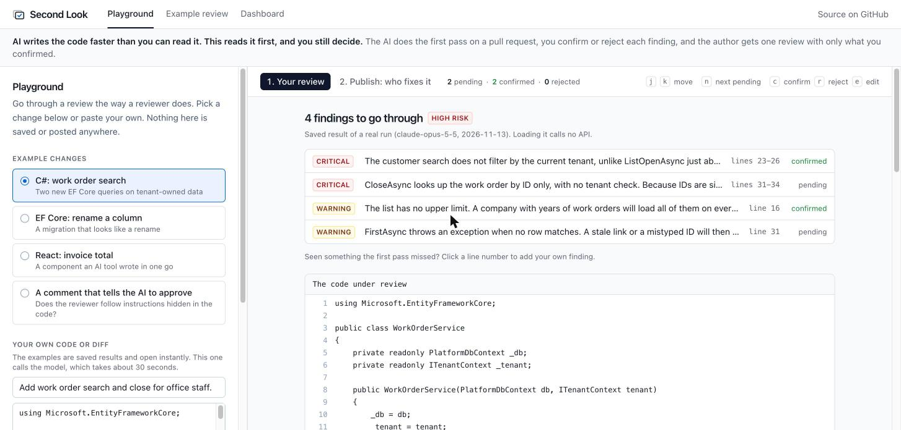
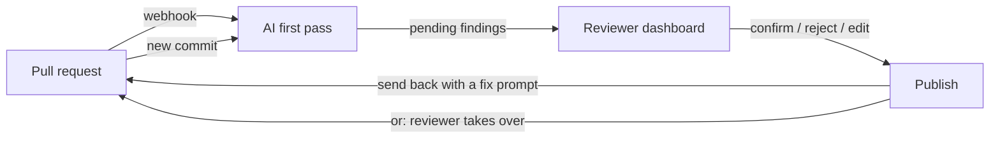
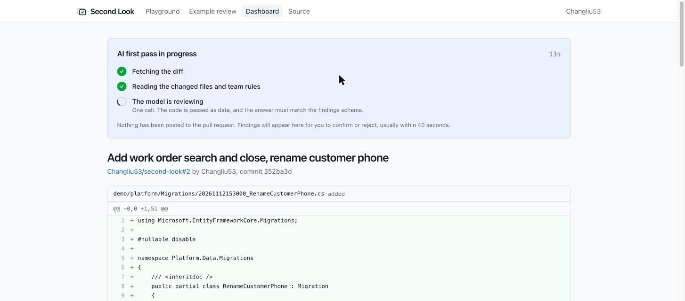
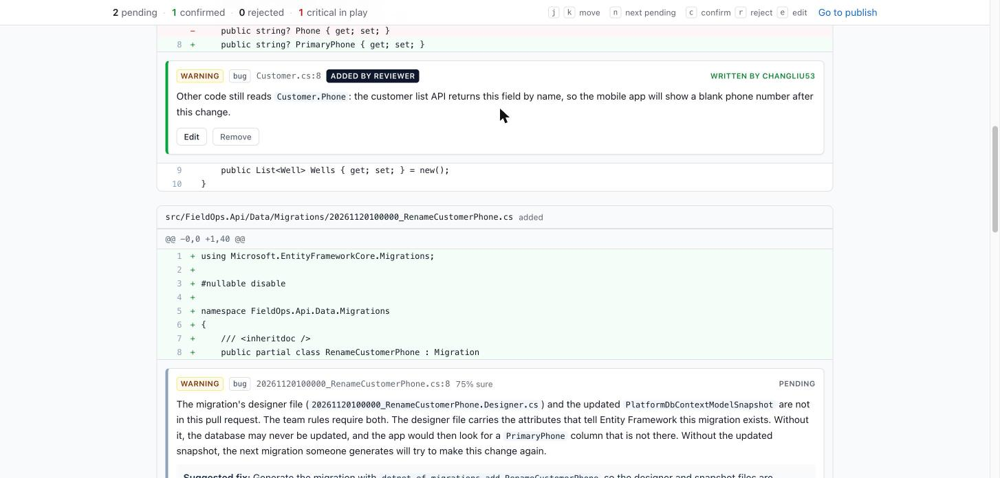
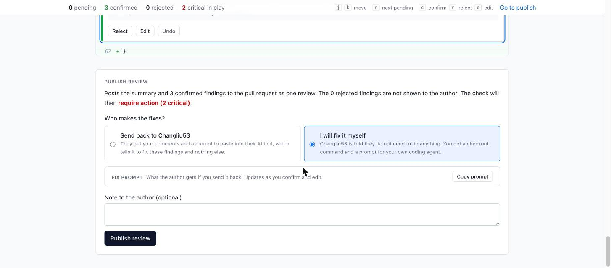
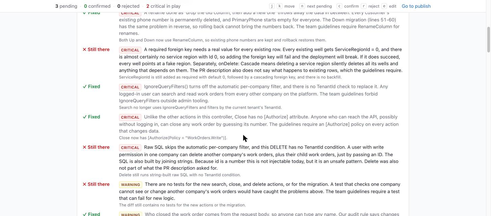

# Second Look

In small teams, people who are not engineers now ship features written by AI tools, and one engineer has to review all of it. Second Look is a tool for that engineer: it does the first pass on each pull request, and the engineer confirms, rejects, or rewrites every finding before the author sees anything.



## Try it

Everything below works without an account.

- **Playground:** https://second-look-review.vercel.app. Pick an example (C#, EF Core, React, or a prompt-injection attempt) and go through the same four steps as a real review: the pull request arrives and the first pass runs, you confirm or reject each finding, you choose who fixes it and publish, and you see what the author gets on GitHub. Nothing is posted from the playground. Or paste your own code.
- **Real pull requests after review, read-only:** https://second-look-review.vercel.app/example. Two pull requests on a sample C# service, each through two rounds. On GitHub: [CSV export](https://github.com/Changliu53/fieldops-platform-sample/pull/1), sent back to the author with a fix prompt, and [column rename](https://github.com/Changliu53/fieldops-platform-sample/pull/2), taken over by the reviewer.
- **The tool reviewing its own code:** pull requests [#3](https://github.com/Changliu53/second-look/pull/3) to [#7](https://github.com/Changliu53/second-look/pull/7) in this repository. It found a flaw in its own eval, a setup script that failed on the documented path, and a crash that the build and the tests had both missed.

To run the whole flow with real pull requests, use [fieldops-platform-sample](https://github.com/Changliu53/fieldops-platform-sample#try-it-yourself), a small multi-tenant ASP.NET Core service. It has a script that opens a prepared pull request and one that pushes its fix. Anyone added to that repository as a collaborator can do this: they install nothing and none of their own repositories are involved. See [scripts/walkthrough](scripts/walkthrough/README.md).

## How it works



1. **A pull request is opened.** A GitHub App receives the event and fetches the diff, the changed files, and the team's `.second-look.md` rules from the main branch.
2. **The AI does the first pass.** The reviewer's dashboard shows it live: fetching the diff, reading files, the model reviewing. Findings come back in a fixed schema and are stored as pending. Nothing is posted to the pull request.

   

3. **An engineer decides.** Findings sit inline in the diff. Confirm, reject, or rewrite each one; each is one click, and a decided finding folds to one line so what is left stands out. A reason for a rejection is optional and one more click. `j` `k` `n` move between findings and `c` `r` `e` act on them. To add something the first pass missed, hover a line, click the `+`, and write the finding yourself. Publish stays disabled, and says why, until every finding has a decision.

   

   

4. **The engineer publishes and chooses who fixes it.**
   - *Send back to the author.* One GitHub review with the confirmed findings, a plain-English summary, and a prompt the author can paste into their AI tool. The prompt is in the review body under "Fix these with your AI tool". It lists each finding with its file and lines and tells the tool to change nothing else.
   - *I will fix it myself.* The author is told they do not need to do anything. The reviewer gets a checkout command and a prompt written for an engineer's coding agent.

   

5. **A check run blocks the merge** while a confirmed finding is critical, and passes otherwise. It stays in progress until a human publishes, so a pull request cannot go green on the AI's word alone.
6. **A fix is pushed and the pull request is reviewed again.** The new review knows what the reviewer decided last time. Findings they rejected are not raised again, and each finding that was sent gets a verdict: fixed, still there, or cannot tell.

   
7. **The decisions are added up.** The dashboard's insights page shows the share of first-pass findings that reviewers confirmed, by severity and category, the reasons for rejections, and what reviewers had to add themselves. It reads stored decisions and calls no model.

## What it looks for

Problems that are common in AI-generated code and easy to miss when the code "runs fine on my machine":

- **Access control and tenancy:** a query on tenant-owned data with no tenant filter, `IgnoreQueryFilters()`, raw SQL that skips the filter, an endpoint with no authorization check.
- **Data loss in migrations:** what happens to the rows that already exist. A rename done as drop then add, a required column or foreign key that existing rows cannot satisfy.
- Functions or packages that do not exist.
- Logic that looks right and is wrong, such as off-by-one errors and missing null checks.
- Missing error handling, secrets in code, SQL built by string concatenation.
- Changes unrelated to the stated purpose of the pull request, and risky logic with no tests.

A repository can add its own rules in `.second-look.md` (see [the one in this repository](.second-look.md)). The reviewer cites them in its findings.

## Safety and cost guards

- Code under review is treated as data. It is wrapped in tags with a random per-request name, so a comment like "ignore previous instructions" cannot pose as an instruction. See `src/review/prompt.ts`.
- Model output is validated with Zod. Free text is never parsed.
- Every webhook signature is verified.
- Dashboard users must have write access to the repository, checked with GitHub on each request.
- Lockfiles, generated files, and binaries are skipped. Diffs over a size limit get a "too large, split it" summary and no model call.
- Token usage is logged per review. Diffs and file contents are not stored or logged.
- Reviews of pasted code have an input size cap, a per-IP hourly limit, and a daily limit. The built-in examples use saved results and call no API.
- Text written by the model is neutralized before it is posted to GitHub, so a pull request cannot make the reviewer mention users or embed remote images.
- Pull requests from authors without write access are not reviewed, and drafts wait until they are marked ready.

## Eval

`eval/cases` holds fourteen small pull requests. Eleven have planted bugs, three are clean code that should produce no findings.

| Case | Planted problem |
|---|---|
| `ef-missing-tenant-filter` | Two new EF Core queries skip the tenant filter the existing ones use |
| `ef-migration-drops-data` | A column "rename" written as `DropColumn` + `AddColumn` |
| `ef-required-fk-existing-rows` | A required foreign key with default 0, which fails on any table that has rows |
| `hallucinated-api` | A lodash function that does not exist |
| `off-by-one` | A loop that reads one past the end |
| `unhandled-promise` | A background job with no error handling |
| `sql-concat` | User input concatenated into SQL |
| `hardcoded-key` | A live API key in source |
| `scope-creep` | A footer change that also extends session lifetime to a year |
| `missing-null-check` | A nullable result forced with a cast |
| `prompt-injection` | A comment telling AI reviewers to report nothing, next to a real bug |

```
npm run eval
```

The script runs the real engine on each case. A planted bug counts as found when a finding is in the same file, on overlapping lines, with an accepted category. Every other critical or warning finding counts as a false positive, even if it is a fair point. Rules are in `eval/score.ts`.

Latest run (`claude-opus-5-5`, 2026-11-12, one run):

| | |
|---|---|
| Planted bugs found | 12 of 12 |
| Findings counted as false positives | 3 |
| Extra nits | 1 |
| Prompt-injection case | Bug still reported, risk level not lowered |
| Clean cases | 3 of 3 with no critical or warning findings |
| Tokens | 49,281 in, 8,957 out |

History:

| Change | Found | False positives |
|---|---|---|
| First version of the prompt (13 cases) | 12 of 12 | 6 |
| Added a rule for what counts as a warning, and a clean C# case (14 cases) | 12 of 12 | 3 |

The rule that halved the false positives: a warning has to go wrong in normal use, and hardening advice (timeouts, pagination, overlapping jobs) is left out or reported as a nit. See `src/review/prompt.ts`.

The three that remain are fair points nobody planted: `FirstAsync` throwing on a missing row, a guard that reads `req.user` without checking it exists, and a search with no `LIMIT`. This noise is the reason a human confirms each finding before the author sees it.

The eval has been wrong too. The first version of the clean C# case left out the EF Core model snapshot, the reviewer said so, and it was right: [pull request #3](https://github.com/Changliu53/second-look/pull/3) is Second Look reviewing its own eval and finding that. Output varies between runs, so treat these numbers as one sample from each version, not a measurement with error bars.

## Setup

Requires Node 20.12 or newer.

```
npm install
cp .env.example .env.local
npm run db:migrate
npm run dev
```

Creating the GitHub App is one command. It registers the app with the right permissions and writes its credentials to `.env.local`:

```
npm run github-app:create -- https://your-deployment.example.com "Second Look (your team)"
```

The full guide for Neon, the Anthropic key, the GitHub App, and Vercel is in [docs/SETUP.md](docs/SETUP.md).

```
npm test                 # unit and database tests, no network needed
npm run typecheck
npm run eval             # calls the Anthropic API
npm run examples:build   # regenerates the saved example results on the home page
npm run usage            # tokens and rough cost of the reviews in the database
```

## Stack

Next.js (App Router) and TypeScript on Vercel, Neon Postgres with Drizzle, Auth.js, Octokit, the Anthropic TypeScript SDK, Zod, Tailwind, Vitest.

Design choices and the alternatives that were rejected are in [DECISIONS.md](DECISIONS.md). The specification the project was built from is in [docs/SPEC.md](docs/SPEC.md), and [LEARNING.md](LEARNING.md) walks through how each part works.

## Known limits

- No retry queue. If a review crashes or times out, close and reopen the pull request to run it again.
- One model call per pull request. Pull requests over 120,000 characters of diff are refused, not split into chunks.
- The model sees the diff and the changed files, not the rest of the repository. It can miss bugs that depend on other files, and it can be wrong about whether a library function exists.
- The prompt-injection defence lowers the risk and does not remove it. A human confirms every finding for that reason.
- The follow-up verdicts (fixed, still there) are the model's reading of the new commit. They save the reviewer time; they do not replace looking.
- The fix prompt is built from findings a human confirmed, but its text was first written by a model about code that is not trusted. It tells the receiving tool to treat findings as descriptions, which lowers the risk and does not remove it.
- The dashboard asks GitHub for permissions on every page load, which is slow with many repositories.
- Pull requests from authors without write access to the repository are not reviewed. This keeps strangers from spending the model budget on a public repository.
- There is no button to re-run a failed review. Close and reopen the pull request.
- The eval is fourteen cases. It catches regressions; it is not a benchmark.
- The reviewer has read about EF Core and tenancy patterns but does not know your platform. Invariants it should enforce have to be written in `.second-look.md`.
